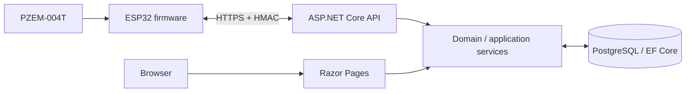

# Architecture

## Current system shape

EMS is a **modular monolith**: one ASP.NET Core .NET 10 deployment contains the API, Identity integration, application/domain services and Razor Pages. PostgreSQL is the cloud persistence layer. The ESP32 is an independently running edge client that communicates over HTTPS.

The current implementation is a monitoring and telemetry platform. Relay actuation, remote commands, local protective trips, alert evaluation and automation are not implemented.

## Component view

See [system-context.mmd](diagrams/system-context.mmd) for the source diagram.

## Backend modules and responsibilities

| Area | Responsibility | Main code location |
|---|---|---|
| Host / composition | Dependency injection, middleware, auth, rate limits, health and Swagger | src/EnergyManagement.Api/Program.cs |
| Identity | Accounts, sign-in, password recovery, household memberships, invitation and audit workflows | Modules/Identity and Web/Pages/Account |
| Households | Household aggregate and access boundaries | Modules/Households, Modules/Identity |
| Devices | Device registration, metadata, thresholds, provisioning and credential lifecycle | Modules/Devices |
| Telemetry | Schema validation, authenticated ingestion, JSONB persistence and history reads | Modules/Telemetry |
| Web read models | Household dashboard and device inventory projections | Web/Services/DashboardReadService.cs |
| Presentation | Server-rendered dashboard, devices, settings and account/household screens | Web/Pages |

The source tree is authoritative. Documentation does not imply a separate microservice or an unimplemented module.

## Edge firmware

The main sketch is in firmware/esp32-arduino/EMS_ESP32:
- PZEM-004T v3.x acquisition through the PZEM004Tv30 library.
- Wi-Fi station connectivity and fresh NTP synchronization.
- HTTPS-only device provisioning with trusted root CA validation.
- Device secret persisted in ESP32 Preferences/NVS.
- HMAC-SHA-256 heartbeat and telemetry requests.
- Random request nonces and UUID sample identifiers.
- Measurement sanity checks and cumulative-energy normalization.
- Persistent offline queue capped at eight complete telemetry samples.
- Retry behavior, duplicate-sample handling and credential rotation.

The separate ESP32_Bench_Diagnostic sketch is dependency-free and does not use Wi-Fi, sensors or GPIO outputs.

## Main data paths

1. An administrator registers a device under an authorized household.
2. An administrator requests a short-lived provisioning code after the required authorization/reauthentication checks.
3. The ESP32 connects to Wi-Fi, synchronizes time, exchanges the code over validated HTTPS and stores its device secret in NVS.
4. The ESP32 signs heartbeat and telemetry requests. The API validates device status, credential, signature, timestamp and nonce.
5. Telemetry validation checks schema version, sample ID, UTC capture time, measurement bounds, phases and optional sensor count.
6. Accepted payloads are persisted as JSONB with server receipt time. Duplicate sample IDs are rejected as conflicts.
7. Authenticated household members can query history for devices in their household. The dashboard reads each device's latest stored sample.

## Identity and trust boundaries

Human browser sessions and ESP32 device credentials are separate principals. Household access must be derived from server-side membership. Client-supplied household/device identifiers are selectors only, never authorization proof.

Device provisioning uses a short-lived one-time code. Device API requests use HMAC signatures with timestamp and nonce replay checks. TLS certificate validation is mandatory in firmware. Do not log secrets, provisioning codes or signatures.

## Persistence

PostgreSQL and EF Core are used for cloud data. Core energy/device persistence and Identity/security persistence have separate contexts and migration histories. Telemetry payloads are stored as JSONB. ESP32 Preferences/NVS is used for device credentials, meter energy metadata and the bounded queue. Flash encryption and secure-boot provisioning are explicitly unchanged and out of scope.

## Architectural invariants

- Local device operation must not require cloud availability for safe measurement behavior.
- No cloud path may become a time-critical protection dependency.
- No relay or load-control behavior is present in current firmware.
- Keep portable firmware logic separate from ESP32-specific drivers.
- Keep HTTP endpoint concerns out of domain invariants.
- Keep household authorization checks at server-side boundaries and in read services.
- Use forward-only database migrations; never rewrite an applied migration.
- Do not add speculative empty modules or abstractions.

## Known gaps

Alert threshold evaluation, durable notifications, historical charts, billing, automation, load control, firmware command polling, physical safety feedback and production-grade operational controls remain future work. See [Feature catalogue](FEATURES.md).
